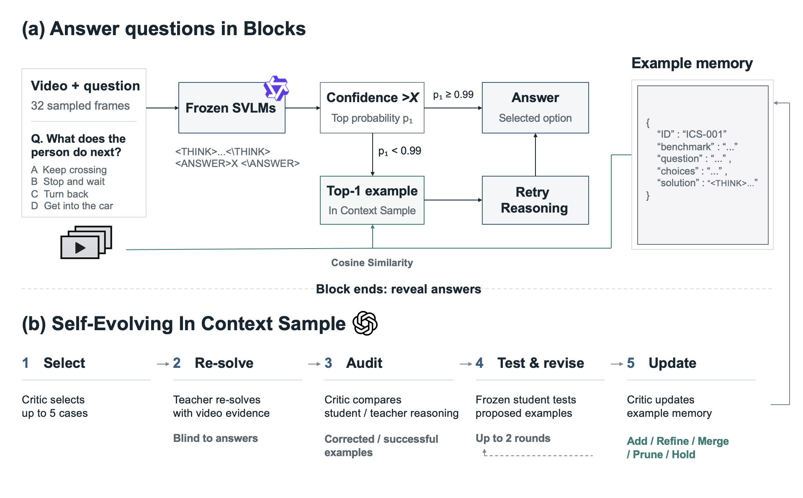
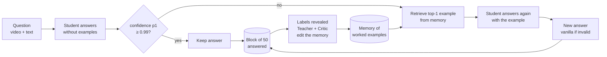

# Knowledge Distillation via Self-Evolving In-Context Samples

**Confidence-gated in-context samples with a self-evolving memory for video question answering.**

A small, frozen video-language model answers multiple-choice video questions.
- **When it is confident**, its answer is kept as is.
- **When it is unsure**, it gets one solved example from a memory of its own past solving records, and answers
  again.

After every block of questions, a teacher LLM revises that memory. The student is never fine-tuned: only the memory
of worked examples evolves.

| | |
|---|---|
| 🎓 Student | Qwen3.5-9B (NF4, 32 frames, greedy decoding), frozen |
| 🔎 Retriever | WeMM-Embedding-2B (video + question + options) |
| 🧑‍🏫 Teacher / Critic | gpt-6.1-sol |
| 📏 Gate | answer-token confidence p1 < 0.99 |

---



## 📊 Results at a glance

| | Urban Video Bench | VideoSIS | Video-MME |
|---|:---:|:---:|:---:|
| Vanilla | 40.56% | 57.75% | 57.15% |
| **Ours** | **42.95%** | **59.60%** | **58.11%** |
| Difference | **+2.39 pp** | **+1.85 pp** | +0.96 pp |
| 95% CI (video bootstrap) | [+1.40, +3.35] | [+0.81, +2.93] | [−0.15, +2.07] |
| Questions given an example | 38% | 45% | 38% |
| Gain on those questions | **+6.30 pp** | **+4.16 pp** | +2.55 pp |
| Teacher cost | $27.54 | $27.74 | $11.37 |

- Every question is compared with vanilla, one by one, in the same order.
- Full reports:
  - [`final_report_en.md`](results_nov/results_final/final_report_en.md) ([Korean](results_nov/results_final/final_report.md))
  - [`subset_analysis.md`](results_nov/results_final/subset_analysis.md)
  - [`protocol_en.md`](results_nov/results_final/protocol_en.md)

**Motivation.** On a 20% stratified sample, one retrieved example changed low-confidence answers (p1 < 0.95) much
more often than very confident ones (p1 ≥ 0.999):

| | Urban | VideoSIS | Video-MME |
|---|:-:|:-:|:-:|
| Change rate, p1 < 0.95 | 64% | 64% | 58% |
| Change rate, p1 ≥ 0.999 | 37% | 27% | 15% |
| Difference [95% CI] | +26 pp [+17, +35] | +37 pp [+27, +47] | +43 pp [+31, +54] |

See [`results_motiv/analysis.md`](results_nov/results_motiv/analysis.md).

---

## 🧭 How it works



### Step 1 · Answering a question

1. **Vanilla answer.** The student answers with no example.
2. **Confidence.** At the answer token (`>A`, `>B`, …), we take the probabilities of the question's own option
   letters, renormalise them, and use the largest one as **p1**.
3. **Gate.**
   - If p1 ≥ 0.99, the answer is final.
   - Otherwise (or if p1 cannot be read), retrieve one example:
     - candidates are the memory items from **other videos**;
     - we pick the one whose source question is most similar (WeMM cosine; no similarity floor);
     - its options are shuffled, and it is inserted after the video.
4. **Re-answer.** The student answers again with the example. If that output is invalid, the vanilla answer is
   kept.

### Step 2 · Evolving the memory (after every block of 50)

The block's labels are revealed **only after** all its answers are fixed. Then five LLM calls edit the memory:

| # | Call | Sees the video? | Sees the labels? | What it does |
|:-:|---|:-:|:-:|---|
| 1 | **Critic: select** | ✗ | ✓ | Reads the block's records and picks up to **5 cases** worth a visual re-check (errors, examples that broke a correct answer, copied examples, uncovered question types). |
| 2 | **Teacher: solve** | ✓ 32 frames | **✗ (blind)** | Solves those cases from the frames, question and options only, with the evidence per frame. |
| 3 | **Critic: write** | ✗ | ✓ | Compares the student's and the teacher's solutions. From the cases the teacher solved correctly, it writes **example candidates** in the student's own output format (≤ 1,300 characters). |
| 4 | **Critic: validate** (1–3×) | ✗ | ✓ | The student re-answers up to 12 past low-confidence questions from other videos **with each candidate attached**. The critic reads the results (did it help, did it copy?) and revises the candidates. |
| 5 | **Critic: manage** | ✗ | ✓ | Using the memory, the validated candidates and each item's usage record (fixes and breaks), it applies **add / merge / prune / refine / hold**. At most 20 items are active. |

- Teacher and critic are the same model, gpt-6.1-sol; only call 2 sees frames.
- A block costs about 6–7 calls and **≈ $0.26**.
- The student's re-answers in call 4 run on the local GPU, not through the API.

---

## 🎬 Benchmarks

Download the benchmarks from their original sources. They are **not** redistributed here.

| Benchmark | Source | Questions used | Used in |
|---|---|:-:|---|
| **Urban Video Bench** | [EmbodiedCity/UrbanVideo-Bench](https://huggingface.co/datasets/EmbodiedCity/UrbanVideo-Bench) | 5,355 | main, motivation |
| **VideoSIS** (SIS-Bench, *Self in Space*) | [choucsan/SIS-Bench](https://huggingface.co/datasets/choucsan/SIS-Bench) · [paper](https://arxiv.org/abs/2607.12477) · [GitHub](https://github.com/IntelliSensing/Self-in-Space) | 4,852 | main, motivation |
| **Video-MME** (v1) | [lmms-lab/Video-MME](https://huggingface.co/datasets/lmms-lab/Video-MME) · [project page](https://video-mme.github.io/home_page.html) | 2,700 | main, motivation |

32 frames are sampled per video. Frames go under `dataset/`.

---

## 🚀 Quick start

**Requirements:** Python 3.10 and an NVIDIA GPU (CUDA 11.8 wheels). We used 4× RTX 2080 Ti (11 GB).

**1. Environment**
```bash
git clone https://github.com/Jewoo-Park/Knowledge-Distillation-via-Self-Evolving-In-Context-Sample.git
cd Knowledge-Distillation-via-Self-Evolving-In-Context-Sample
python3.10 -m venv .venv
.venv/bin/pip install -r requirements.txt
.venv/bin/python -m pytest -q          # unit tests, no GPU or network needed
```

**2. Model weights**
```bash
.venv/bin/huggingface-cli download Qwen/Qwen3.5-9B --local-dir models/Qwen/Qwen3.5-9B
.venv/bin/huggingface-cli download tencent/WeMM-Embedding-2B \
    --revision bbd6cd4bf52cfc6716f752a2df80b2706720bd95 --local-dir models/tencent/WeMM-Embedding-2B
```

**3. OpenAI API key** (teacher and critic)
```bash
.venv/bin/python scripts/configure_api_key.py   # stored in .secrets/openai_api_key (git-ignored)
```

**4. Inputs.** Prepare these from the benchmarks and put them in `data/inputs/`:

| File | Content |
|---|---|
| `stream.jsonl` | all questions, in their fixed order |
| `vanilla.sqlite`, `videosis_vanilla_rows/` | the student's vanilla answers |
| `query_embeddings.sqlite`, `encoder_signature.json` | WeMM query vectors (`scripts/embed_queries.py`) |
| `answer_probs.sqlite` | p1 of every vanilla answer (`scripts/compute_p1.py`) |

**5. Run**
```bash
source scripts/icl_env.sh
.venv/bin/python scripts/compute_p1.py --gpus 0,1,2,3
.venv/bin/python scripts/run_icl_confidence.py --config configs/final_c.yaml --gpus 0,1,2,3
```

- The three benchmarks run side by side, each with its own memory.
- A run **resumes** from its last finished block. Teacher responses are cached, so a restart costs nothing.
- `teacher.max_usd` in the config caps the spend.
- Results are written every 5 blocks.

> **Version pinning.** `torch`, `transformers` and `bitsandbytes` are pinned exactly. At startup the run checks that
> the student's runtime matches the one that produced the vanilla answers, and stops if it does not.

---

## 📁 Repository layout

```
configs/final_c.yaml             the method's configuration
scripts/
  run_icl_confidence.py          main run: confidence gate, retrieval, block loop, the five LLM calls
  run_icl_stages.py              the teacher/critic stages, memory operations, student input
  run_icl_evolution.py           shared setup (data, vanilla answers, vectors, GPU pool, API client), generation
  compute_p1.py                  confidence p1 of every vanilla answer (one forward pass each)
  embed_queries.py               WeMM query vectors
  final_export.py                per-benchmark result files
  prepare_videosis.py            VideoSIS -> sample format
src/                             model adapter, datasets, answer parser, prompts, retrieval, memory, API client, stats
tests/                           unit tests
results_nov/
  results_final/                 main experiment: reports, protocol, config used, per-question records, memories
  results_motiv/                 motivation experiment: outputs with token log-probabilities, analysis
```

Each benchmark folder in `results_final/` contains:

| File | Content |
|---|---|
| `model_output.jsonl` | one row per question: p1, shown example, student answer, vanilla answer |
| `memory.jsonl` | the final memory, including inactive items and their history |
| `block_curve.jsonl` | accuracy per block, memory size, cumulative teacher cost |
| `summary.md` | accuracy, CI, results by confidence band |

Every JSONL file starts with a summary line.

---

## 🔁 Reproducibility

| Part | Reproducible? |
|---|---|
| Student outputs (vanilla and with an example) | ✅ **byte-identical**. In a fresh clone and environment, 42/42 regenerated outputs matched. |
| Confidence p1 | ✅ identical (12/12) |
| Memory evolution (teacher / critic) | ⚠️ runs end to end, but API models are not deterministic, so a rerun builds a different memory and the final accuracy will differ somewhat |

The reported run's per-question records, memories and exact config (`config_used.json`) are all in
`results_nov/results_final/`.

<details>
<summary><b>Known issues in the reported run</b></summary>

- **Option letters inside examples.** When an example's options are shuffled, letters written as plain words
  (e.g. "D is the only beef option") are not remapped. Only `option D`, `(D)` and `D.` are.
- **Critic prompts vs. retrieval.** The stage-4/5 prompts say that items are retrieved by their `when_to_use` text and
  that held items are never shown. The run actually retrieved by the source question's vector and also showed held
  items.
- **Threshold choice.** 0.99 was chosen on the same questions, using a different (frozen) memory. Thresholds between
  0.95 and 0.995 were within 0.3 pp of each other on average.
- **Data preparation.** The scripts that extract frames, build `stream.jsonl` and generate vanilla answers are not
  included.

</details>
